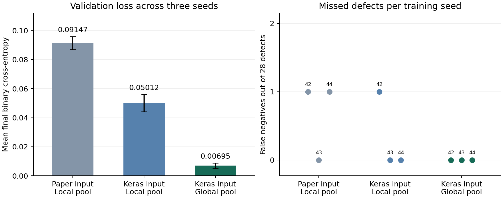

[English](README.md) · [中文简介](README.zh-CN.md)

# VGG16 Defect Detection for 3D-Printed Cylinders

IDAT7215 Group 8 · Study One · 271 original images

## Experimental setup

We used the group’s fixed Study One split of 271 cylinder images. It contains 189 training images, 27 validation images, and 55 test images. We resized each image to 224 × 224 and froze the ImageNet-pretrained VGG16 backbone. We trained only the classification head, which used a 64-unit ReLU layer, dropout of 0.5, and a two-class softmax output. Each configuration ran for 50 epochs with Adam, a learning rate of 0.001, and a batch size of 30. We repeated each run with seeds 42, 43, and 44. [Shared split](study_one/split.csv) · [Training code](study_one_vgg16.py)

### Step 1. Input preprocessing

We first tested whether the input preprocessing mattered. The baseline divided RGB values by 255, as in the authors’ example code. In the second configuration, we used Keras’s VGG16 preprocessing on the original pixel range. It converts RGB to BGR and subtracts the ImageNet channel means. We kept the pooling layer and classifier unchanged for this comparison. [Authors’ notebook](https://github.com/mahsan2/AM3d/blob/dd1025d7180d91f1128c95817b4d3dd268626b1e/basic_algorithm.ipynb) · [Keras VGG16 documentation](https://keras.io/api/applications/vgg/vgg_models/)

### Step 2. Global average pooling

We then kept the Keras preprocessing and changed the pooling layer. The baseline’s 4 × 4 average pooling used a stride of 4 and valid padding. On a 7 × 7 feature map, this gives one pooling window covering 16 of the 49 spatial positions. Global average pooling uses all 49 positions in each channel. Both methods produce 512 features, so the classifier has the same number of trainable parameters in both runs.

## Results

Accuracy and defect recall are reported as the mean ± sample standard deviation across the three seeds. Standard deviations are in percentage points. We used a fixed defect probability threshold of 0.5.

| Configuration | Mean final validation loss | Test accuracy | Defect recall | Misses at seeds 42 / 43 / 44 |
|---|---:|---:|---:|---:|
| RGB divided by 255 + local average pooling | 0.09147 | 98.79% ± 1.05 | 97.62% ± 2.06 | 1 / 0 / 1 |
| Keras preprocessing + local average pooling | 0.05012 | 99.39% ± 1.05 | 98.81% ± 2.06 | 1 / 0 / 0 |
| Keras preprocessing + global average pooling | 0.00695 | 100.00% ± 0.00 | 100.00% ± 0.00 | 0 / 0 / 0 |

Changing the preprocessing reduced the number of misses from two to one across the three runs. After switching to global average pooling, each run correctly classified all 28 defective and 27 non-defective test images. All nine runs had a test ROC AUC of 1.00, so the differences in missed defects came from which scores fell below the fixed threshold. We selected the global-pooling configuration because it had the lowest mean final validation loss. For group fusion, we averaged its three defect probabilities for each test image. [Per-seed metrics](study_one/results/per_seed.csv) · [Confusion matrix](study_one/results/fusion/confusion_matrix.png)

The 100% accuracy applies to the same 55 test images in all three runs. We checked the image timestamps and found that 48 test images had a same-class training image taken within 30 seconds. This proximity may make the test easier than evaluating new prints. To measure performance on independent prints, we would need to hold out entire print runs.

## Reproduction and group fusion

Follow the [reproduction instructions](study_one/README.md) to download the pinned original images and rerun the nine experiments. The repository includes the trained classifier heads, learning curves, per-image predictions, and experiment configuration.

Use the [three-seed prediction CSV](study_one/results/fusion/teammate_schema.csv) for group fusion. Join by `path` and average `probability_0`, the probability of a defect in the shared export format. All 55 paths and labels were verified against the teammate's Study One predictions. A [fixed seed 42 export](study_one/results/fusion_seed42/teammate_schema.csv) is available for comparisons that use one trained head per architecture.
