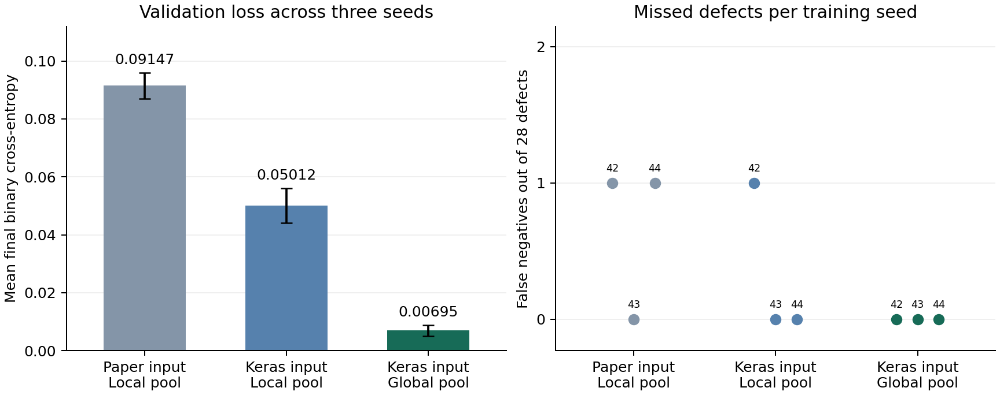

[English](README.md) · [中文简介](README.zh-CN.md)

# VGG16 三维打印圆柱缺陷检测

本项目是 IDAT7215 第 8 组的 Study One 实验。我们在固定的 271 张图像上比较了三种 VGG16 配置，分别检验输入预处理和全局平均池化的影响。每种配置使用三个随机种子。

Keras 官方预处理配合全局平均池化的平均验证损失最低。三个种子分别正确分类了固定测试集的全部 55 张图，其中包括 28 张缺陷图。55 张测试图中有 48 张在训练集中有拍摄时间相近的同类照片，独立打印批次上的表现仍未验证。

- [英文报告与结果表](README.md)
- [复现实验说明](study_one/README.md)
- [用于小组融合的逐图预测 CSV](study_one/results/fusion/teammate_schema.csv)
